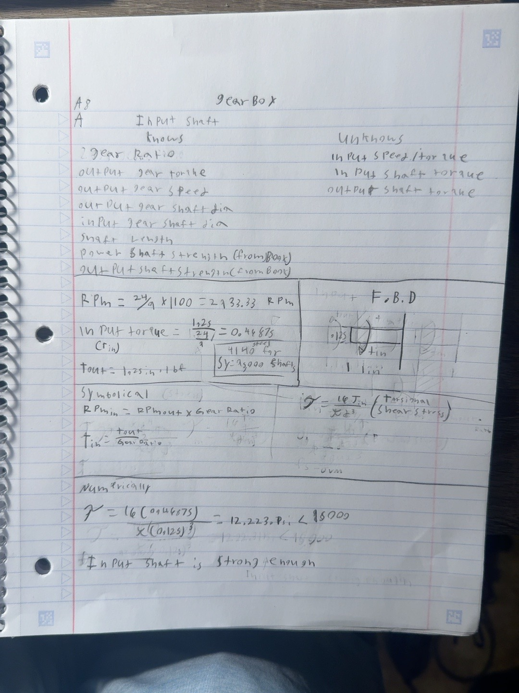
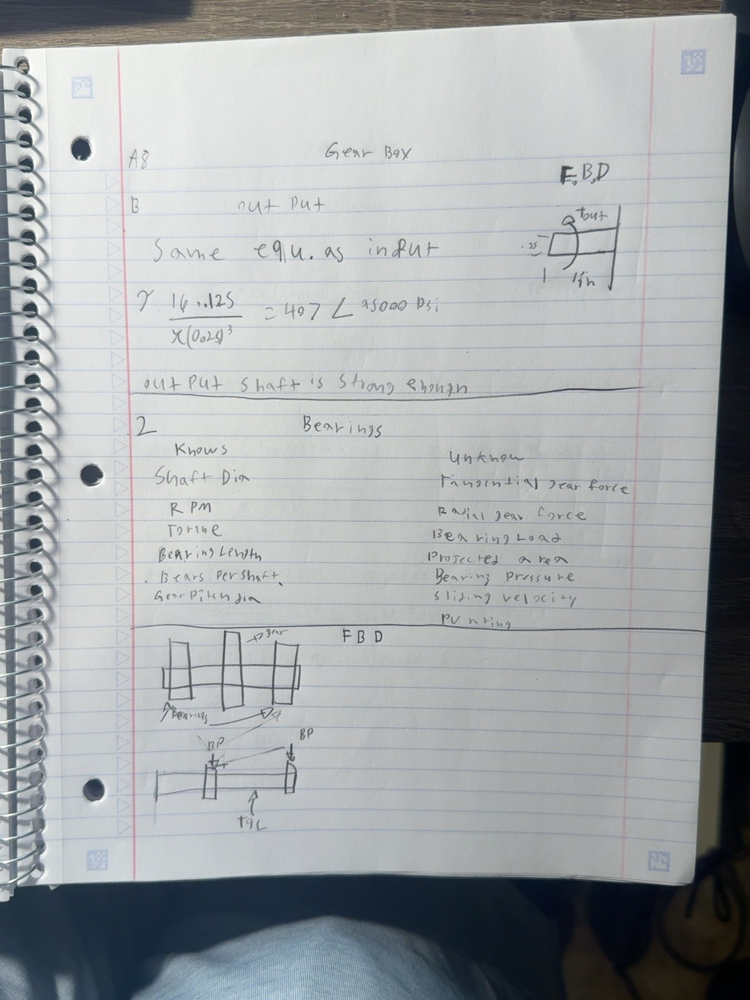
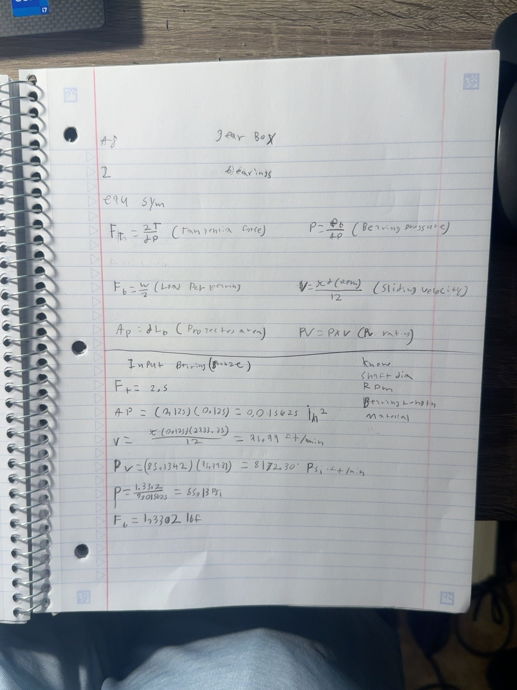
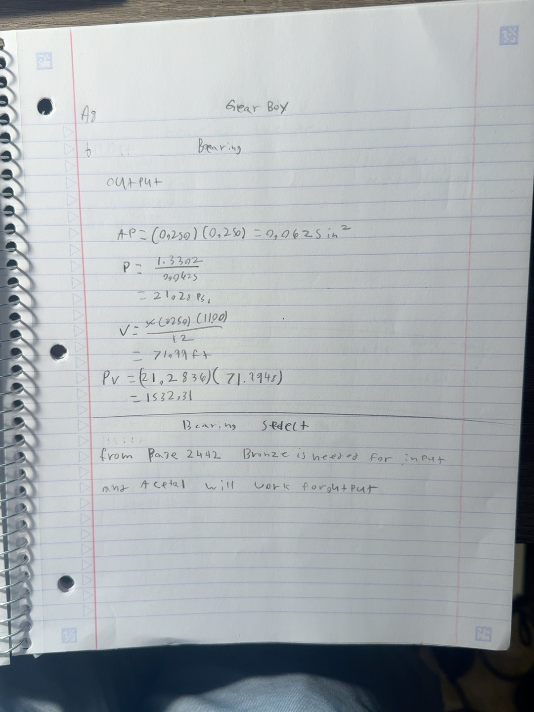
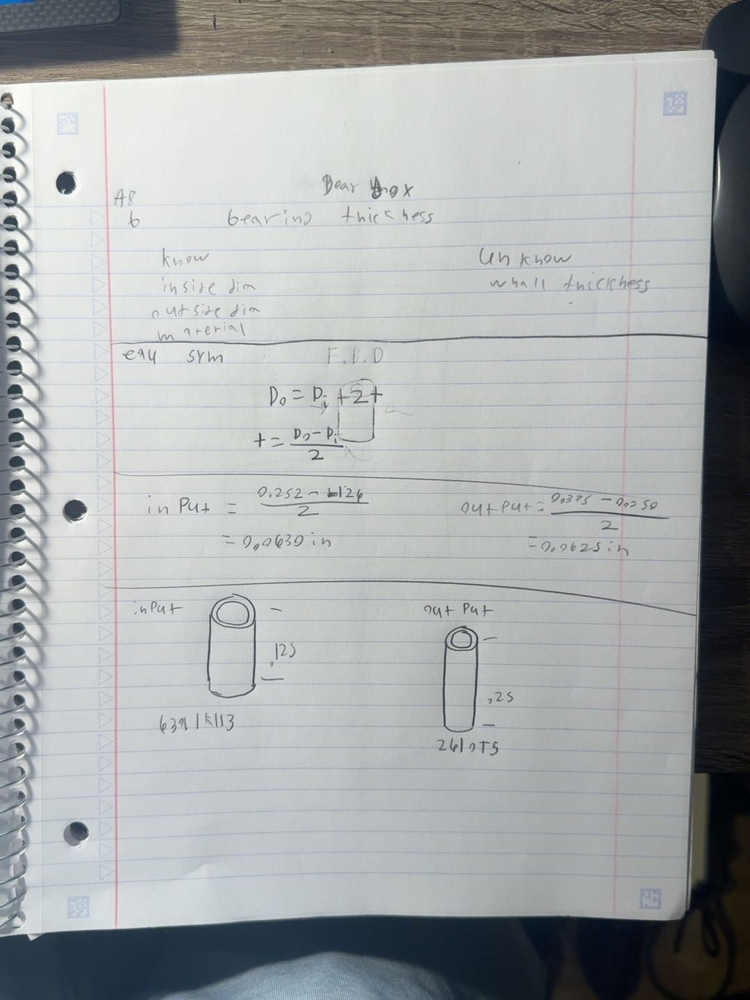
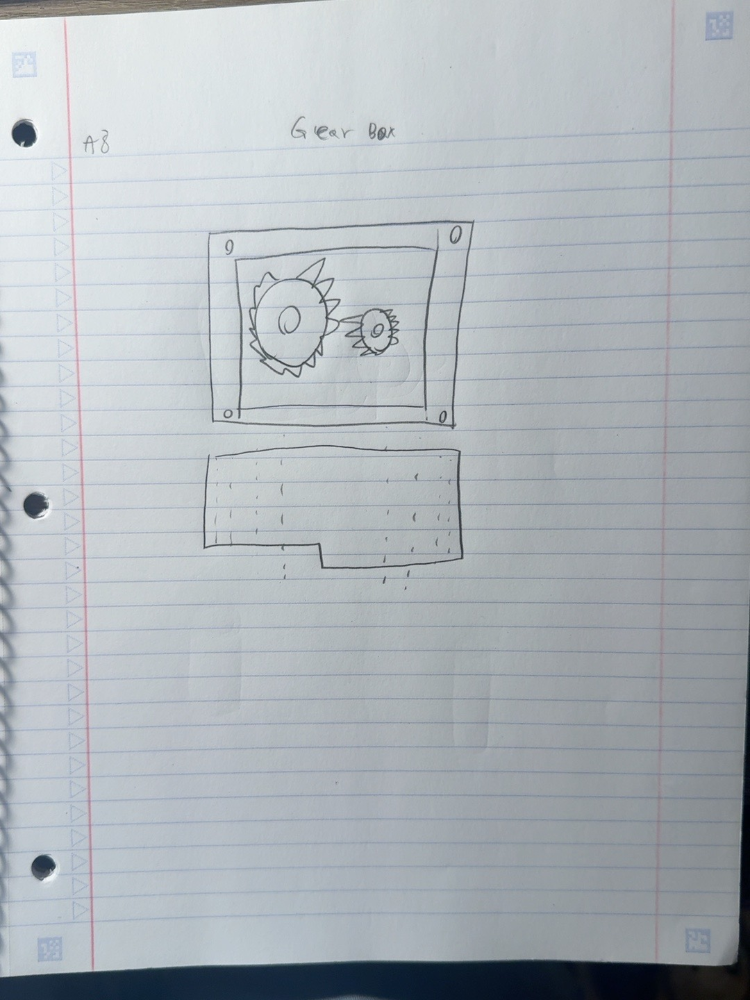
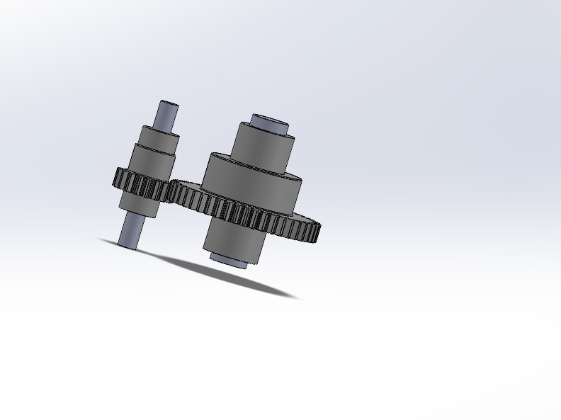
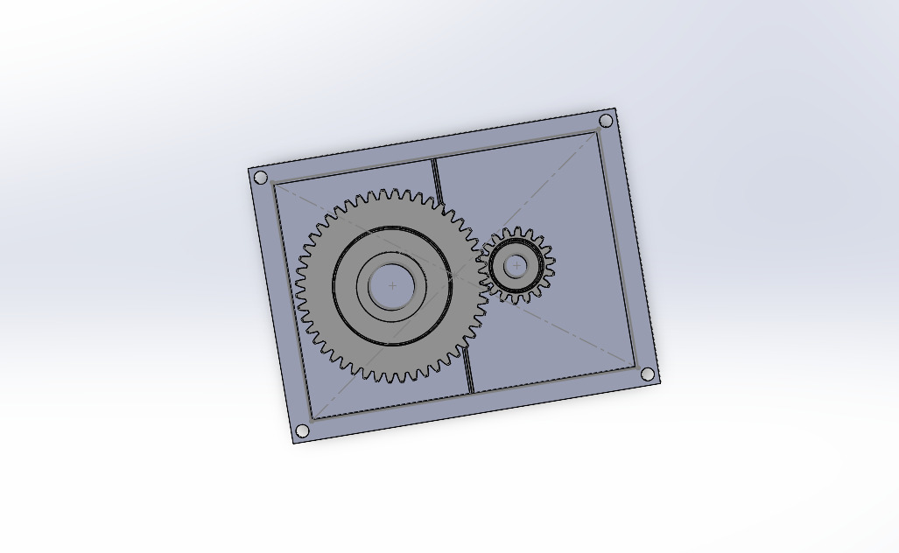
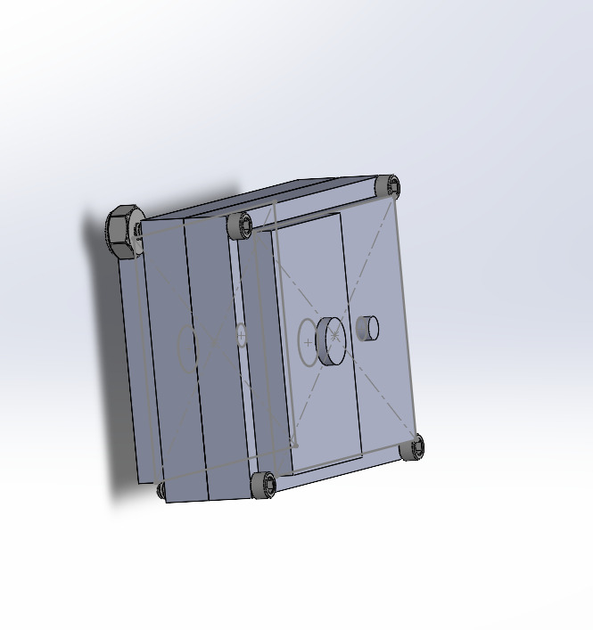

# A8 – Gearbox Design

## Objective

The objective of this assignment was to design a gearbox that could be assembled and disassembled. I needed to check the strength of the input and output shafts, design journal bearings to support both shafts, and create a two-piece housing in SOLIDWORKS. I also needed to ensure the gears had enough clearance to rotate freely and that the housing could be disassembled.

The gearbox uses two spur gears with a 24:9 gear ratio. The output gear delivers 1.25 in-lbf of torque and rotates at 1,100 rpm. The input and output shafts have diameters of 0.125 in and 0.250 in, and both shafts are 1 in long.

### Design requirements

- Gear ratio: 24:9
- Output torque: 1.25 in-lbf
- Output speed: 1,100 rpm
- Input shaft diameter: 0.125 in
- Output shaft diameter: 0.250 in
- Shaft length: 1 in each
- Use journal bearings to support the shafts
- Make sure the gears have enough clearance
- Design a housing that can be assembled and disassembled
- Use parametric modeling in SOLIDWORKS

## Analyze

I started this project by going through the assignment requirements and identifying all the knowns and unknowns. Before designing anything in SOLIDWORKS, I wanted to make sure that the shafts and bearings would work with the given gear ratio, torque, and speed.

I broke my calculations into three main sections: shaft strength, journal bearing design, and bearing wall thickness.

### Shaft strength

The first step was determining whether the given shaft diameters were strong enough to handle the torque from the gears. I started by listing my knowns and unknowns and drawing free-body diagrams for both shafts.

I used 4140 steel for the shafts and referenced the strength information in Machinery's Handbook. Since the gear train was assumed to be ideal, I could use the gear ratio to calculate the input torque and speed.

I started with the input shaft and used the gear ratio to determine the speed and torque. I then used the torsional shear stress equation for a solid circular shaft to check the given diameter.

I used the same shear stress equation for the output shaft, but with its larger diameter and the given output torque.

The input shaft had the higher torsional shear stress even though it transmitted less torque. This was because its diameter was much smaller than the output shaft's diameter.

Both calculated stresses were well below the material strength value I referenced. Based on this simplified torsional stress check, I determined that both given shaft diameters were sufficient.

### Journal bearing design

Once I finished the shaft calculations, I moved on to designing the journal bearings. I needed bearings to support each shaft while allowing them to rotate inside the gearbox.

I decided to use two bearings per shaft. To select the bearings, I needed to determine the pressure, sliding velocity, and PV rating. These values would help me choose an appropriate bearing material.

I first found the tangential force from the gears and used the bearing loading assumptions to determine the approximate force on each bearing.

I used an estimated load of approximately 1.33 lbf per bearing from my bearing calculations. I then worked through the equations for both the input and output bearings.

For the input shaft, I selected a bearing length of 0.125 in, which matched the shaft diameter.

Because the input shaft rotates at a higher speed, the bearing experienced a higher sliding velocity and PV rating.

For the output shaft, I selected a bearing length of 0.250 in.

The output bearing had a lower pressure and PV rating because of its larger projected area and lower rotational speed.

After calculating these values, I referenced the plain bearing material information in Machinery's Handbook to compare different materials.

I selected bronze as the candidate material for the input bearing because it needed to handle the higher PV value. For the output bearing, I selected acetal as a candidate because it operated at a lower pressure and sliding velocity. The exact catalog limits and operating conditions would still need to be checked before manufacturing.

### Bearing wall thickness

After choosing the bearing materials, I needed to determine the wall thickness and outside diameter of each bearing.

I used the inside and outside diameters of the selected bushings to calculate their wall thickness.

The equation was:

**Wall Thickness = (Outside Diameter - Inside Diameter) / 2**

For the input bearing:

- Inside diameter: 0.126 in
- Outside diameter: 0.252 in
- Wall thickness: 0.0630 in

For the output bearing:

- Inside diameter: 0.250 in
- Outside diameter: 0.375 in
- Wall thickness: 0.0625 in

These dimensions helped me determine the required housing openings for the bearings.

I also needed to consider the fit between the shaft and bearing. The input bearing has a nominal clearance of 0.001 in, but the output bearing has the same nominal inside diameter as the shaft. The actual manufacturing tolerances would need to be checked to make sure the output shaft could rotate freely.

### McMaster-Carr parts

Once I had the bearing sizes and materials, I identified bushings from McMaster-Carr that were close to the dimensions I needed.

| Component | Material | Part Number |
|---|---|---|
| Input shaft bushing | Bronze | 6391K113 |
| Output shaft bushing | Acetal | 2619T5 |

These were the candidate part numbers I recorded in my notes. I would verify their catalog dimensions, fits, and load ratings before ordering.

The main advantage of using an existing bushing rather than designing my own was that I could use its dimensions when modeling the gearbox. This also made the design more realistic since the bearings could be purchased instead of manufactured.

## Design

After finishing my calculations, I moved into the actual gearbox design. I wanted to make sure my housing would support the two shafts, allow the gears to rotate without interference, and be easy to assemble and disassemble.

### Initial hand sketch

Before opening SOLIDWORKS, I drew a basic sketch of what I wanted the gearbox to look like.

I decided on a rectangular housing with the larger output gear on one side and the smaller input pinion on the other. The two shafts would pass through the housing and be supported by journal bearings.

I also planned to use bolts at the four corners to secure the two housing pieces together. This would allow me to remove the cover to access the gears and shafts.

### Initial CAD model

I started the CAD portion by modeling the gears and shafts together in SOLIDWORKS. I wanted to get the gear assembly positioned correctly before designing the housing around it.

I used the assigned gear ratio and shaft diameters to help position the parts. I also made sure that the two shafts were parallel and that the gear teeth meshed correctly.

Having the gear assembly modeled first gave me a much better idea of how much room the housing needed and where the bearings would need to go.

### Gearbox housing

Once the gear assembly was in place, I started designing the housing around it.

I used a rectangular shape because it was simple to model and provided enough space for the gears and their shafts. I needed to make sure that the housing walls were far enough away from the gear teeth so nothing would rub while the gears were rotating.

I also included openings for the shafts and bearings. The bearing locations were especially important because the shafts needed to remain properly aligned for the gears to mesh.

For fastening, I added holes at the four corners of the housing so that the two sections could be secured together with bolts.

### Housing assembly and clearances

After creating the basic housing, I checked the opposite side of the model to see how everything fit together.

One of the main things I focused on was making sure there was enough clearance around the gears and shaft openings. I also needed to leave enough room for the bearings and fasteners without interfering with any moving parts.

The removable housing design means that the two halves can be separated to access the gears, bearings, and shafts.

I also checked the placement of the corner fasteners and the openings on the underside of the housing to make sure the design was practical for assembly.

## Reflections

This assignment helped me understand how much planning and calculation goes into designing something as simple-looking as a gearbox. Before starting, I thought the main challenge would be making the housing in SOLIDWORKS, but the shaft and bearing calculations were a big part of the process.

One of the biggest things I learned was how much the diameter of a shaft affects its strength. Even though the output shaft transmitted more torque, its larger diameter resulted in a lower torsional shear stress.

I also learned that selecting a bearing requires more than finding one that fits around a shaft. I needed to consider the pressure, speed, PV rating, and material before making a selection.

I had to be careful with some of my calculations, especially when working with the smaller shaft dimensions. Going back through my work, I corrected the input shaft shear stress to 1,222 psi. This showed me why it is important to check calculations before moving into CAD.

Another thing I learned was how important clearance and assembly access are when designing a housing. It is easy to make something that looks correct in SOLIDWORKS, but the parts also need enough room to move, and the housing needs to be able to come apart.

Overall, this assignment helped me connect the calculations from class to an actual mechanical assembly.

## Communicate

**Time spent:** [Enter actual hours]

**CAD files:** [Insert GitHub link to SOLIDWORKS files]

**Conclusion:** I designed a two-piece gearbox using the given 24:9 spur gear ratio and shaft dimensions. I checked the input and output shafts for torsional strength, calculated the pressure and PV ratings for the journal bearings, and selected candidate bearing materials and sizes. I then used SOLIDWORKS to model the gear assembly and create a housing around it. The calculations supported the given shaft sizes, and the CAD model provided a design for an assembly that could be taken apart for maintenance. Before manufacturing, I would verify the bearing fits, catalog ratings, and final housing clearances.
