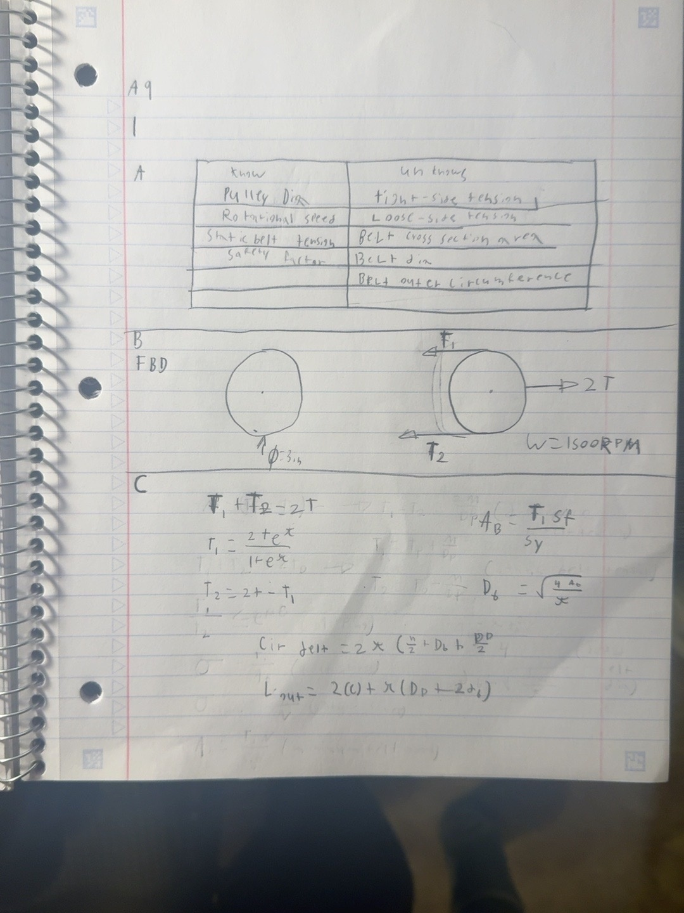
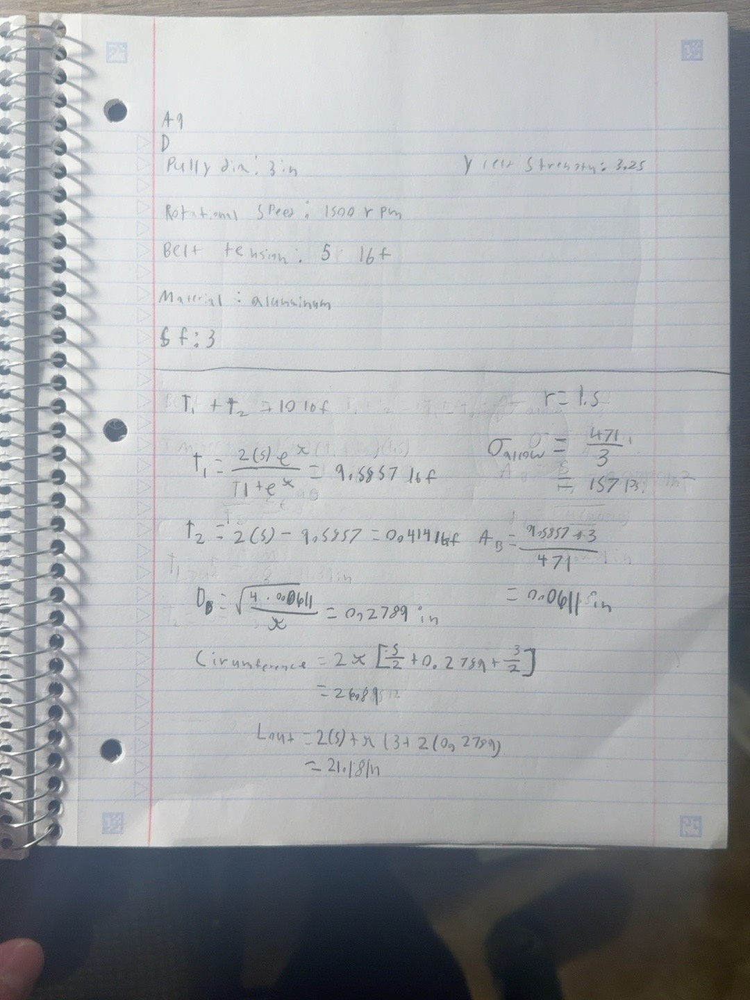
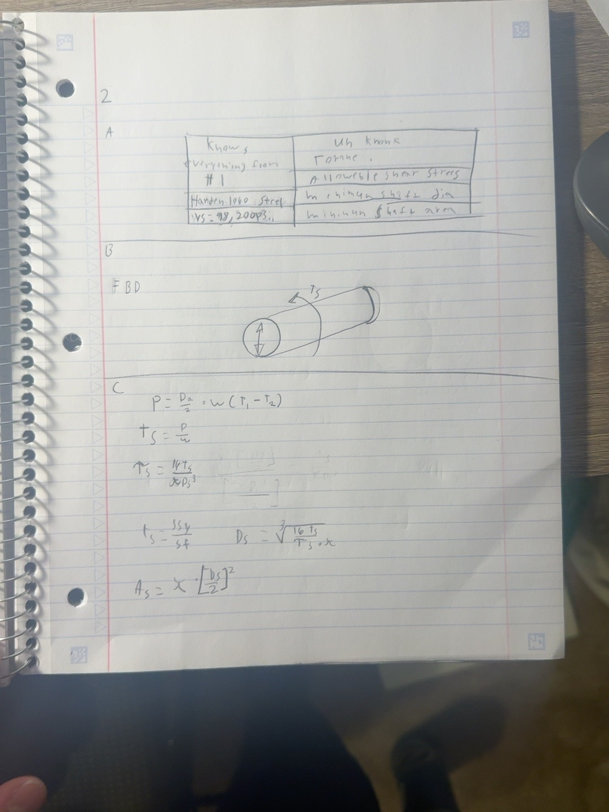
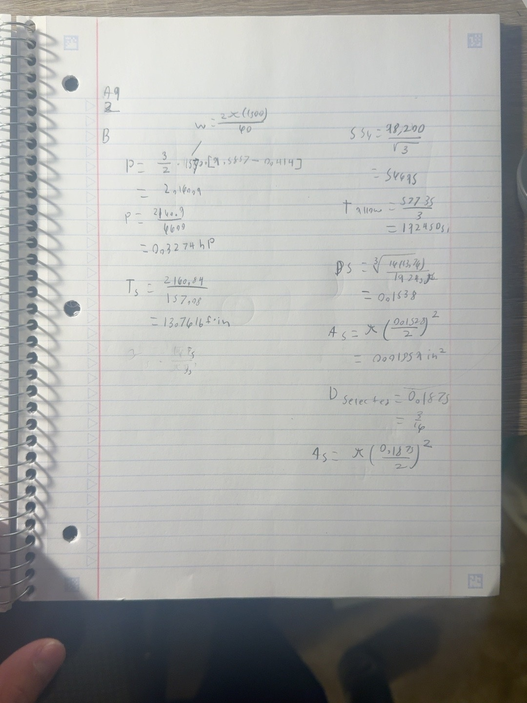
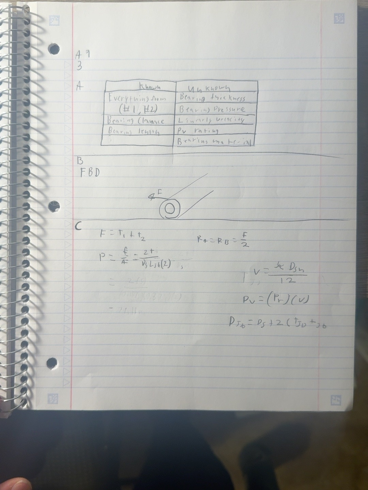
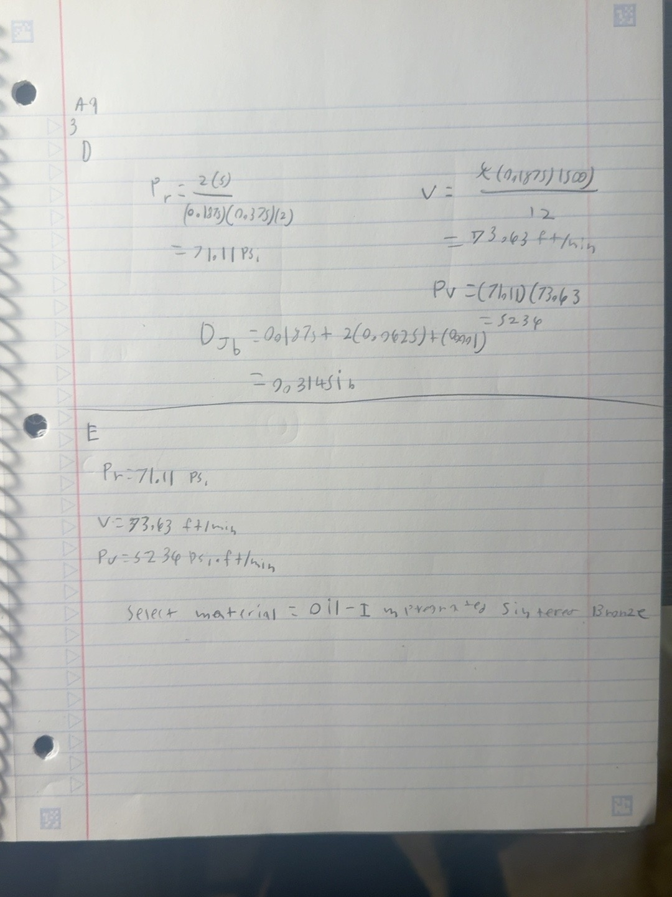

# A9 – Pulley System Design

# Objective

  The objective of this assignment was to design a pulley system
  that could transfer power between two parallel shafts. I needed
  to select a suitable belt, calculate the minimum shaft diameter,
  design journal bearings, and create a frame to support the system.
  I also needed to make sure the belt could transmit power without
  slipping and that the components could handle the applied forces.

  The system uses 3-inch diameter pulleys rotating at 1,500 rpm
  with an initial belt tension of 5 lbf. I selected a center distance
  of 5 inches, which was within the required range of 4–6 inches.
  The design uses a polyurethane rubber belt, hardened 1060 steel
  shafts, and aluminum for the supporting frame. The required
  safety factor was 3.

# Design requirements

  - Pulley diameter: 3 in
  - Rotational speed: 1,500 rpm
  - Static belt tension: 5 lbf
  - Pulley center distance: 4–6 
  - Selected center distance: 5 
  - Safety factor: 3
  - Belt material: Polyurethane rubber
  - Shaft material: Hardened 1060 steel
  - Frame material: Aluminum
  - Select a suitable round belt
  - Calculate the minimum shaft diameter
  - Design journal bearings to support the shafts
  - Design a frame to support the pulley system

# Analyze
  I started this project by reviewing the assignment requirements
  and identifying all the knowns and unknowns. Before selecting
  any components, I wanted to make sure the belt, shafts, and
  bearings could support the forces generated by the pulley system.
  I divided my calculations into three main sections: belt selection,
  shaft strength, and journal bearing design. After completing
  these calculations, I moved on to the supporting frame design.

# Belt selection 

  The first step was determining the forces on the tight and loose
  sides of the belt. I started by listing the known values and
  drawing a free-body diagram of the pulley. Since the initial
  belt tension was 5 lbf, I used the relationship between the
  tight-side and loose-side tensions to determine the forces
  acting on the pulley.
  
  I used the belt friction equation to determine the limiting
  tension ratio before slipping. Assuming a coefficient of
  friction of 1 and a wrap angle of 180 degrees, I calculated
  a tight-side tension of 9.5857 lbf and a loose-side tension
  of 0.4143 lbf. These values represent the limiting no-slip
  condition used for the design calculations.

  After finding the tensions, I calculated the minimum
  cross-sectional area of the belt. I used polyurethane rubber
  with an assumed strength of 471 psi at 20% strain and applied
  the required safety factor of 3. This gave an allowable stress
  of 157 psi and a minimum belt area of approximately
  0.0611 in².
  
  Using the area of a circle, I calculated a minimum round
  belt diameter of 0.2789 in. I then selected a 5/16-inch
  diameter polyurethane belt since it was larger than the
  calculated minimum.
  
  I also needed to determine the belt circumference. I selected
  a 5-inch center distance between two 3-inch pulleys and used
  the selected belt diameter to calculate an approximate
  outer circumference of 21.39 inches. This gave me a target
  circumference when looking for a suitable belt. The final
  catalog selection would still need to account for the
  manufacturer's belt sizing and installation requirements.
  
  
  
# Shaft strength

  Once I finished selecting the belt, I moved on to calculating
  the minimum shaft diameter. I used hardened 1060 steel for
  the shaft, as required by the assignment. I started by
  drawing a free-body diagram and using the difference between
  the tight-side and loose-side belt tensions to calculate
  the torque transmitted through the pulley.

  Using the 3-inch pulley diameter and the previously calculated
  belt tensions, I found a transmitted torque of approximately
  13.76 in-lbf. At 1,500 rpm, this corresponds to approximately
  0.327 hp under the assumed limiting no-slip condition.

  I then used the torsional shear stress equation for a solid
  circular shaft to calculate the minimum diameter. I referenced
  an assumed yield strength of 98,200 psi for the hardened
  1060 steel and applied the required safety factor of 3.

  Using the von Mises shear yield criterion, I calculated a
  minimum shaft diameter of approximately 0.155 in. I selected
  a standard 3/16-inch shaft, which was larger than the
  minimum required diameter for torsion alone.

  This calculation helped me determine a preliminary shaft
  size that could transmit the required torque. However, the
  shaft would also experience bending forces from the belt,
  so the final shaft design would need an additional bending
  stress check.

# Journal bearing design

  After calculating the shaft diameter, I moved on to designing
  the journal bearings. The bearings needed to support the
  shaft while allowing it to rotate at 1,500 rpm. I decided
  to use two journal bearings per shaft and assumed the pulley
  was positioned between the bearings.

  I started by calculating the radial load acting on the
  bearings. Since the tight-side and loose-side tensions
  totaled 10 lbf, I assumed the load was distributed equally
  between the two bearings. This resulted in an estimated
  bearing load of 5 lbf per bearing.
  

  I used the selected 3/16-inch shaft diameter and an assumed
  bearing length of 0.375 in to calculate the projected bearing
  area. I then divided the bearing load by this area to determine
  the bearing pressure.
  
  The calculated bearing pressure was 71.11 psi. I also used
  the shaft diameter and rotational speed to calculate a
  sliding velocity of 73.63 ft/min. Multiplying the pressure
  by the velocity gave a PV value of approximately
  5,236 psi-ft/min.
  
  These values were important because they allowed me to
  compare the operating conditions with the pressure and
  PV limits of different bearing materials. I referenced
  the plain bearing material section of Machinery's Handbook
  to help identify a suitable material.

# Bearing material selection

  After calculating the bearing pressure and PV value, I
  selected oil-impregnated sintered bronze as my preliminary
  journal bearing material. Sintered bronze contains pores
  that retain lubricating oil, helping reduce friction and
  wear between the bearing and the rotating steel shaft.

  I selected this material because it is commonly used for
  rotating shafts and provides lubrication during operation.
  The bearing material would need an allowable pressure of
  at least 71.11 psi and a PV rating of at least
  5,236 psi-ft/min. The final material selection would require
  checking the specific manufacturer's ratings.

# Bearing dimensions

  After selecting the bearing material, I needed to determine
  the bearing wall thickness and outside diameter. I used
  the selected shaft diameter of 0.1875 in and assumed a
  bearing wall thickness of 0.0625 in and a radial
  clearance of 0.001 in.
  
  Using these preliminary dimensions, I calculated an
  approximate bearing outside diameter of 0.3145 in.
  This helped me estimate the amount of space required
  to mount the journal bearings into the supporting frame.
  The actual bearing dimensions and running clearances
  would need to match the selected catalog component.

# Frame Design

  After completing the belt, shaft, and bearing calculations,
  I moved on to designing a frame to support the pulley system.
  I selected aluminum because of its relatively low weight,
  corrosion resistance, and ease of machining. The frame needed
  to maintain the 5-inch distance between the pulley centers
  while keeping the shafts properly aligned.

  I used the bearing reaction forces to estimate the loads acting
  on the frame. For a preliminary support calculation, I modeled
  an aluminum bearing support as a cantilever and used bending
  stress equations to evaluate its strength. With the assumed
  dimensions and material properties, the calculated bending
  stress was 960 psi, below the allowable stress of approximately
  11,667 psi.

  This showed that the preliminary support dimensions were
  sufficient for the assumed bending load. I also needed
  to consider mounting locations, bearing alignment, and
  clearance around the pulleys. The complete frame and its
  connections would still need to be checked before manufacturing.

# Engineering Lessons Learned

  One of the main things I learned from this assignment was
  how belt tension affects the entire pulley system. The
  difference between the tight-side and loose-side tensions
  determines the torque transmitted through the shaft, while
  friction and the pulley wrap angle limit how much power
  can be transferred without slipping.

  I also learned how the different components depend on one
  another. The belt forces determine the shaft loading,
  the shaft dimensions affect the bearing design, and the
  bearing reactions determine the loads that the supporting
  frame must carry. Calculating these values in order helped
  me understand why selecting one component can affect the
  dimensions and material requirements of the rest of the system.

  Another important lesson was the difference between a
  calculated minimum dimension and a practical component
  selection. Both the belt and shaft required rounding up to
  available sizes, while the journal bearing design required
  checking material ratings and clearances. 

  I spent 4 hours on this assignment 
